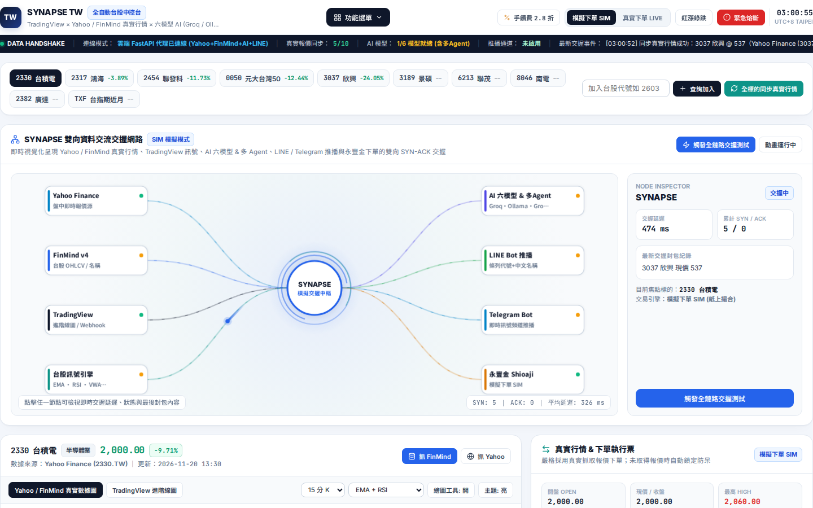
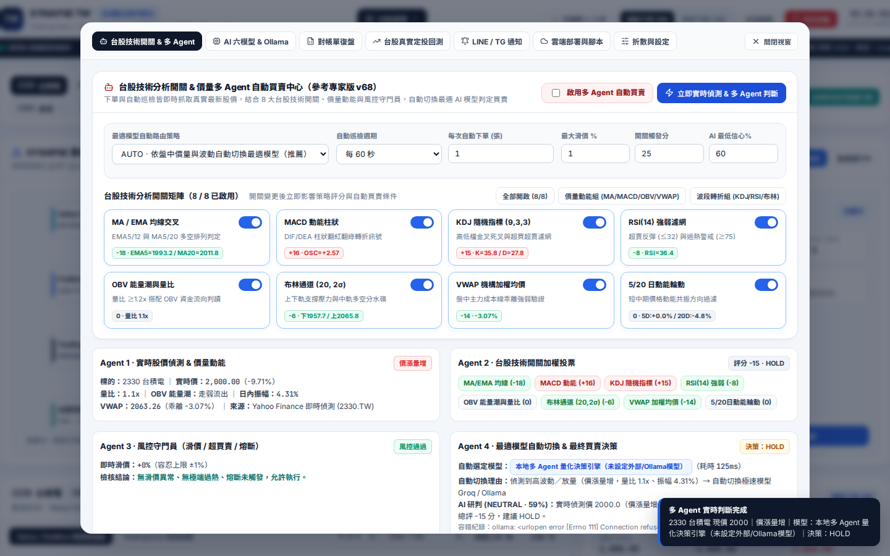
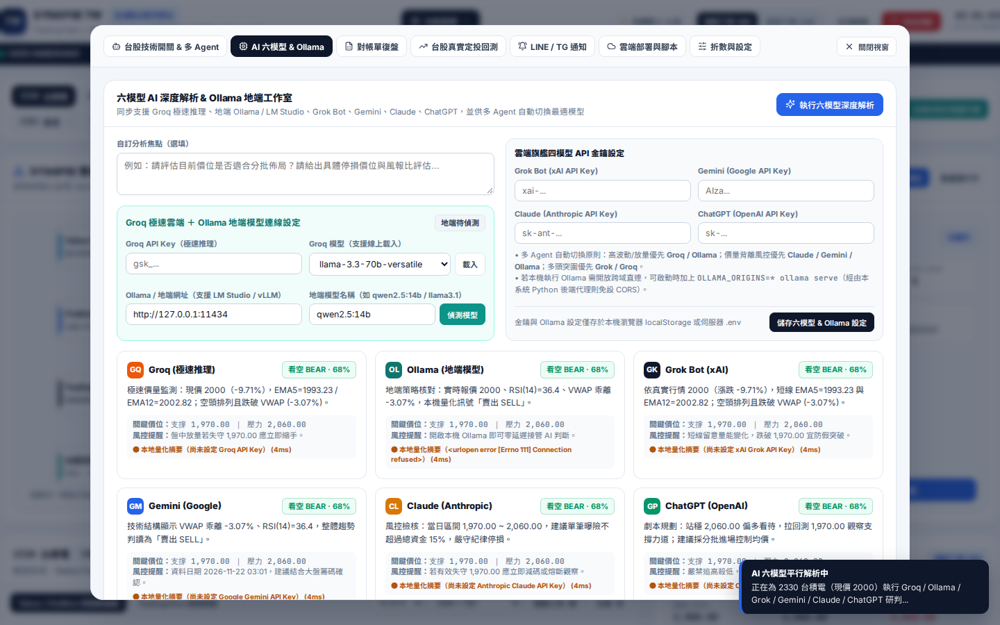
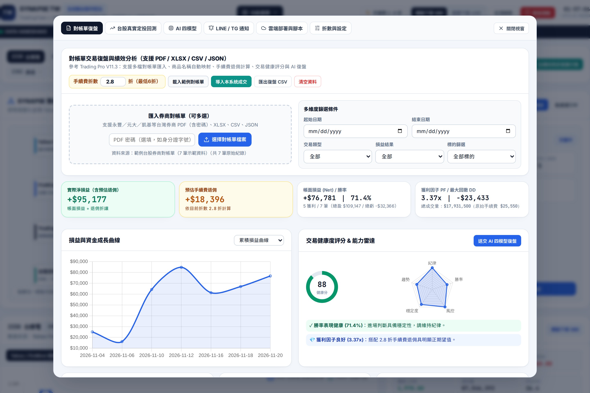
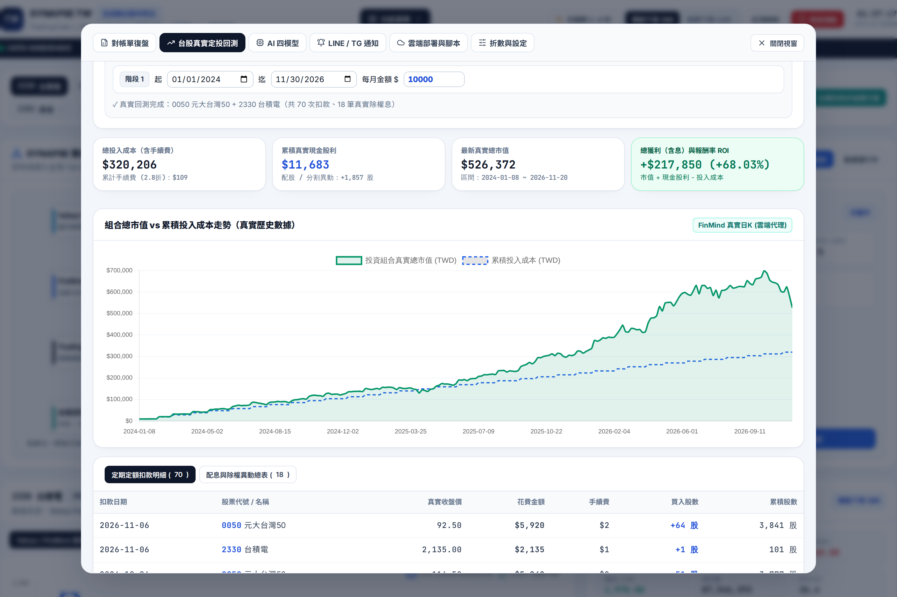
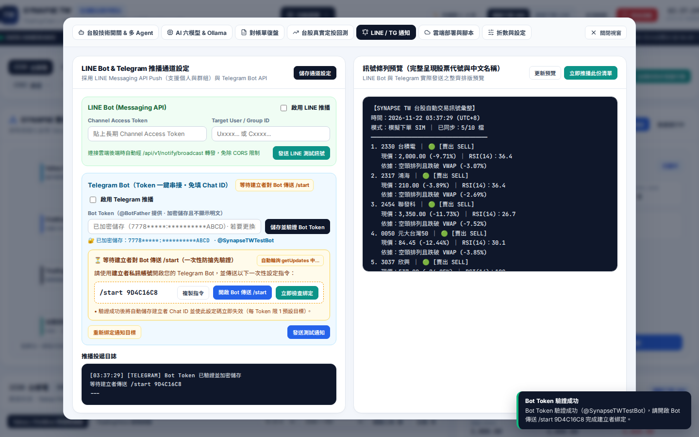
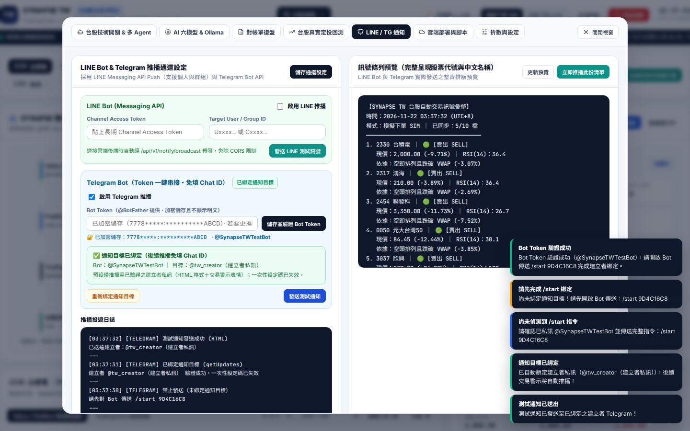

# SYNAPSE TW · 全自動台股交易系統（TradingAutomatic）


**SYNAPSE TW** 是一套支援**雲端部署**與**單檔免安裝直接執行**的全自動台灣股市交易系統網頁版，整合 **雙向資料交流交握視覺化**、**TradingView 進階線圖與帳號串接**、**Yahoo Finance / FinMind 真實台股行情（嚴禁猜測）**、**六模型 AI（Groq 極速推理 · Ollama 地端模型 · Grok · Gemini · Claude · ChatGPT）**、**下單實時偵測股價 ＋ 價量多 Agent 自動選模**、**8 大台股技術分析開關自動買賣**、**LINE Bot / Telegram 條列通知**、**對帳單復盤**、**台股真實定投回測**，以及 **模擬下單（SIM）／真實下單（LIVE）安全切換**。

---

## 介面截圖（v3.0.0 實機渲染）

### 1. 總覽指揮台：雙向資料交流交握網路 × 選單彈窗架構
> 60fps 呈現 Yahoo Finance、FinMind v4、TradingView、台股訊號引擎、AI 六模型 & 多 Agent、LINE Bot、Telegram 與永豐金 Shioaji 之間的即時 `SYN-ACK` 雙向交握封包；進階模組統一收合於頂部「**功能選單 ▾**」彈窗，保持主畫面簡潔。



### 2. 下單實時偵測最新股價 ＋ 價量多 Agent 自動選模預檢
> 送單前自動繞過快取即時抓取最新真實股價、計算即時滑價，同步執行價量動能 Agent、8 大技術開關投票與風控守門員，並依盤中量比／振幅／背離自動切換最適 AI 模型（若遇超買賣、滑價超標或方向衝突，系統會彈出警示確認機制）。


### 3. 台股技術分析開關（專家版 v68）& 多 Agent 自動買賣中心
> 將台股核心技術分析整理為 **8 大獨立開關**（`MA/EMA 均線`、`MACD 動能`、`KDJ 隨機指標`、`RSI(14)`、`OBV 能量潮與量比`、`布林通道 (20,2σ)`、`VWAP 機構加權均價`、`5/20 日動能輪動`），搭配 4-Agent 協作與最適模型自動路由策略，啟用後即依策略評分與模型共識自動執行買賣。



### 4. AI 六模型深度解析 & Ollama 地端模型工作室
> 新增 **Groq 極速雲端 API**（支援線上載入可用模型）與 **Ollama 地端模型**（支援自動偵測本機已安裝模型及 LM Studio / vLLM 相容端點），與 Grok、Gemini、Claude、ChatGPT 組成六模型矩陣。



### 5. 對帳單交易復盤（支援 PDF 含密碼 / XLSX / CSV / JSON 匯入與退佣試算）
> 支援券商對帳單匯入、手續費折數（預設 `2.8` 折，可修改，最低 `6` 折）預估退佣計算、交易健康度評分、五維能力雷達圖與一鍵送交 AI 復盤。



### 6. 台股真實定投回測（FinMind 真實歷史股價＋除權息配股）
> 支援多標的權重配置與多階段每月扣款設定，即時向 FinMind 抓取真實歷史日 K 與 `TaiwanStockDividend` 除權息配股資料，計算含息總報酬率 ROI 與手續費折數影響。



### 7. LINE Bot & Telegram 自動綁定通知中心（僅填 Bot Token・免填 Chat ID）
> **Telegram Bot 零門檻安全串接**：畫面僅需貼上 `Bot Token`（免填 Chat ID），後端即以 Encrypt-then-MAC 加密存檔並遮罩顯示，自動產生一次性 `/start <setup_code>` 防搶先設定碼；建立者私訊 Bot 傳送該指令後，系統透過 `getUpdates` 自動取存 `owner_chat_id` 並令設定碼失效，後續交易警示自動以 HTML 格式推播至建立者。




### 8. RWD 行動裝置自適應介面（390px 零水平溢出）
> 手機解析度下交握拓撲與卡片自動自適應排版，零水平溢出。

<p align="center">
  
</p>

---

## 核心功能（v3.1.0）

| 模組 | 說明 |
| :--- | :--- |
| **1. Telegram Bot 單欄位 Token 自動綁定推播** | 僅輸入 `Bot Token`（無 Chat ID 欄位）→ 驗證 `getMe` → Encrypt-then-MAC 加密存檔與畫面遮罩 → 產生一次性 `/start <setup_code>` → 輪詢 `getUpdates` 自動取存私訊 `owner_chat_id` 並令設定碼失效（每 Token 限 1 預設目標）；未綁定禁送；支援純文字、Markdown 轉安全 HTML 與交易警示表情；支援一鍵「重新綁定通知目標」與「發送測試通知」。 |
| **2. 六模型 AI（新增 Groq ＋ Ollama 地端）** | 除 **Grok Bot (xAI)**、**Gemini (Google)**、**Claude (Anthropic)**、**ChatGPT (OpenAI)** 外，新增 **Groq 極速雲端推理**（支援線上載入模型清單）與 **Ollama / LM Studio / vLLM 地端模型**（支援 `/api/tags` 一鍵偵測本機模型、原生 `/api/chat` 與 OpenAI 相容端點，並自動濾除 DeepSeek-R1/QwQ `<think>` 標籤）。 |
| **3. 下單實時股價偵測 ＋ 價量多 Agent 自動選模** | 透過 `POST /api/v1/agent/orchestrate`（與前端靜態降級引擎），下單前繞過快取即時抓取最新真實股價、計算滑價，由 **價量動能 Agent**、**技術策略 Agent**、**風控守門員 Agent**、**最適模型自動路由 Agent** 協作處理。支援四種路由策略：`AUTO`、`SPEED_FIRST`、`LOCAL_FIRST`、`DEEP_REASONING`，並具完整容錯切換（Failover）。 |
| **4. 台股技術分析開關（v68）與自動買賣引擎** | 參考台股專家版 v68 報告整理為 8 大獨立技術開關（MA/EMA、MACD、KDJ、RSI(14)、OBV 量比、布林通道、VWAP、5/20日動能輪動），提供全開／價量動能組／波段轉折組預設；啟用自動買賣後可定時實時偵測並依開關評分＋AI 信心門檻＋風控檢核自動執行 SIM / LIVE 委託。 |
| **5. 雙向資料交握視覺化 & 選單彈窗架構** | 60fps Canvas 雙向 `SYN → ACK` 封包、旋轉交握環與節點檢視器；所有進階模組整合至頂部「**功能選單 ▾**」彈窗切換，保持主介面簡潔清爽。 |
| **6. 手續費折數全域連動** | 預設 **`2.8` 折**，可於下單票、復盤彈窗、定投回測與設定中自由修改，最低優惠上限 **`6.0` 折**（超過自動校驗），即時套用至所有手續費與退佣計算。 |
| **7. 對帳單交易復盤 & 台股真實定投回測** | 支援多選匯入 PDF（含密碼解鎖）/ XLSX / CSV / JSON 對帳單復盤與退佣試算；並提供 FinMind 真實歷史股價＋除權息配股定投回測查詢，嚴禁猜測假數據。 |
| **8. TradingView × LINE Bot × SIM/LIVE 切換** | 內嵌 TradingView 進階線圖與帳號／雲端 Layout 綁定、Pine Script v5 Webhook；LINE Bot 條列股票代號＋中文名稱；支援 SIM 模擬盤與永豐金 Shioaji LIVE 實盤安全切換與緊急熔斷。 |

---

## 快速開始（支援直接執行與一鍵打包）

### 方式一：直接下載 GitHub Release 執行（最簡單、免裝 Python）
前往本專案的 **[Releases 頁面](https://github.com/LHSheng-404/TradingAutomatic/releases)** 下載最新版本 `v3.1.0`：

- **Windows（免安裝單檔直接執行）**：
  - 下載 `SYNAPSE-TW-v3.1.0-windows-x64.exe` 直接雙擊執行，自動開啟瀏覽器。
- **macOS（Apple Silicon）**：
  ```bash
  chmod +x SYNAPSE-TW-v3.1.0-macos-arm64
  ./SYNAPSE-TW-v3.1.0-macos-arm64
  ```
- **Linux（免安裝單檔直接執行）**：
  ```bash
  chmod +x SYNAPSE-TW-v3.1.0-linux-x64
  ./SYNAPSE-TW-v3.1.0-linux-x64
  ```
- **跨平台可攜原始碼包**：
  - 下載 `SYNAPSE-TW-v3.1.0-portable.zip`（或 `.tar.gz`），解壓縮後雙擊 `start.bat`（Windows）或執行 `./start.sh`（macOS / Linux）。

啟動後瀏覽器會自動開啟 `http://127.0.0.1:8000`（如欲不開啟瀏覽器或自訂埠號，可加參數 `--port 8080 --no-browser`）。

---

### 方式二：原始碼一鍵啟動

```bash
git clone https://github.com/LHSheng-404/TradingAutomatic.git
cd TradingAutomatic
```

- **Linux / macOS**：
  ```bash
  ./start.sh
  ```
- **Windows**：
  雙擊執行 `start.bat`，或於命令提示字元執行：
  ```cmd
  start.bat
  ```

---

### 方式三：一鍵打包發行版（產出單檔執行檔 + Portable ZIP/TAR.GZ）

本專案內建跨平台一鍵打包腳本 [`package.py`](package.py)：

```bash
pip install -r requirements.txt pyinstaller
python3 package.py --version v3.1.0
```

執行完成後會在 `dist/` 目錄自動產出：
1. `SYNAPSE-TW-v3.1.0-<os>-<arch>`（免安裝單一可執行檔，已內嵌 `index.html`）
2. `SYNAPSE-TW-v3.1.0-portable.zip` 與 `.tar.gz`（跨平台可攜包）
3. `SHA256SUMS.txt`（完整性校驗檔）

> 專案同時包含 GitHub Actions 自動發布管線 [`.github/workflows/release.yml`](.github/workflows/release.yml)，每次推送 `v*` 標籤時會自動於雲端同步編譯 **Windows `.exe`、macOS、Linux** 三平台直出執行檔並上傳至 Release。

---

### 方式四：雲端一鍵部署

#### A. Render.com 全棧部署（推薦，Yahoo / FinMind / 六模型 AI / 多 Agent / LINE / Telegram 加密自動綁定 / Shioaji 全支援）
1. 登入 [Render.com](https://render.com) → **New +** → **Blueprint**。
2. 選擇 `LHSheng-404/TradingAutomatic`（自動讀取 [`render.yaml`](render.yaml)）。
3. 於 Environment Variables 填入您的金鑰（見下方環境變數說明）即可取得 HTTPS 公開網址。

#### B. Docker 容器部署
```bash
cp .env.example .env
# 編輯 .env 填入您的 API 金鑰
docker build -t synapse-tw .
docker run -d -p 8000:8000 --env-file .env --name synapse-tw synapse-tw
```

#### C. 純靜態前端部署（Cloudflare Pages / Vercel / GitHub Pages）
- 本專案已內建 [`.github/workflows/pages.yml`](.github/workflows/pages.yml) 與 [`vercel.json`](vercel.json)，純靜態前端預設直連 FinMind v4 (`Access-Control-Allow-Origin: *`) 真實台股資料；亦可於網頁內「雲端部署與腳本」填入已部署的 FastAPI 後端網址，立即啟用 Yahoo 盤中代理、六模型 AI、多 Agent 與加密 Telegram / LINE 推播。

---

## 詳細使用指南與環境設定

複製 `.env.example` 為 `.env`（切勿將 `.env`、`.synapse_secret.key` 或 `.pfx` 憑證上傳至 Git）：

```env
# 預設模擬盤 SIM；完成實盤風控測試與憑證驗證後方可改為 LIVE
TRADING_MODE=SIM
CHECK_TV_IP=true
TV_WEBHOOK_SECRET=SYNAPSE_TV_SECRET_2026

# 伺服器加密主金鑰（選填；未填時自動於本機生成 0600 權限 .synapse_secret.key 加密儲存 Bot Token）
SYNAPSE_MASTER_KEY=

# FinMind API v4 Token（選填，多組請以逗號分隔輪替）
FINMIND_TOKENS=

# 六模型 AI API 金鑰 & Ollama 地端模型設定（可填入任一或全部）
GROQ_API_KEY=
GROQ_MODEL=llama-3.3-70b-versatile
OLLAMA_BASE_URL=http://127.0.0.1:11434
OLLAMA_MODEL=qwen2.5:14b
XAI_API_KEY=
GROK_MODEL=grok-3-mini
GEMINI_API_KEY=
GEMINI_MODEL=gemini-2.5-flash
ANTHROPIC_API_KEY=
CLAUDE_MODEL=claude-sonnet-4-20250514
OPENAI_API_KEY=
OPENAI_MODEL=gpt-4o-mini

# LINE Messaging API Bot & Telegram Bot（Telegram 建議直接於網頁貼上 Token 自動綁定，免填 Chat ID）
LINE_CHANNEL_ACCESS_TOKEN=
LINE_TARGET_ID=
TELEGRAM_BOT_TOKEN=

# 永豐金 Shioaji 實盤設定（僅 LIVE 模式需要）
SHIOAJI_API_KEY=
SHIOAJI_SECRET_KEY=
SHIOAJI_CA_PATH=./certs/Sinopac.pfx
SHIOAJI_CA_PASS=
```

### 各模組串接說明
1. **Telegram Bot 一鍵自動綁定（僅填 Bot Token・免填 Chat ID）**
   - 向 `@BotFather` 申請 `Bot Token` 後，開啟「**功能選單 → LINE / TG 通知中心**」，於 Telegram 區塊貼上 `Bot Token` 並點擊「**儲存並驗證 Bot Token**」。
   - 系統驗證 Token 有效後即加密存檔（畫面遮罩且不於前端／日誌曝光明文），並產生一次性 `/start <setup_code>` 指令。
   - 使用建立者私訊開啟您的 Bot 傳送該指令，系統會透過 `getUpdates` 自動取存 `owner_chat_id` 並令一次性設定碼失效，隨後點擊「**發送測試通知**」即可驗證；如需更換接收者，點擊「**重新綁定通知目標**」即可重設。
1. **Groq 與 Ollama 地端模型串接**
   - **Groq**：至 [Groq Console](https://console.groq.com/) 取得 `gsk_...` 金鑰，於「功能選單 → AI 六模型 & Ollama」填入後可按「載入」即時抓回所有可用模型（預設 `llama-3.3-70b-versatile`）。
   - **Ollama 地端模型**：本機安裝 [Ollama](https://ollama.com/) 並執行 `ollama pull qwen2.5:14b`（或 `deepseek-r1:14b`、`llama3.1:8b`）後，於設定頁按「**偵測模型**」即可自動讀取本機清單。若經由本系統 Python 後端（`server.py` / 單檔執行檔）啟動則免設 CORS；若使用純靜態網頁直連本機 Ollama，啟動時加上 `OLLAMA_ORIGINS=* ollama serve` 即可。
2. **台股技術分析開關 & 多 Agent 自動買賣**
   - 透過「**功能選單 → 台股技術開關 & 多 Agent 自動買賣**」自由開關 8 項技術指標，選擇模型自動路由策略（推薦 `AUTO`），並設定巡檢週期、最大滑價容忍 %、觸發評分與 AI 最低信心門檻。
   - 主畫面下單票預設勾選「**下單前實時偵測最新股價 ＋ 價量多 Agent 自動選模預檢**」，確保每次送單皆同步最新真實股價並通過滑價與多空衝突保護。
3. **TradingView 帳號與進階快訊串接**
   - 點擊圖表區「**登入 TradingView 進階圖表**」即可在您的已登入帳號開啟同步台股標的，亦可綁定專屬雲端 Layout 網址與 Pine Script v5 Webhook。
4. **LINE Bot & Telegram 設定**
   - **LINE Bot**：至 [LINE Developers](https://developers.line.biz/) 建立 Messaging API Channel，取得 `Channel Access Token` 與 `User ID (U...)` / `Group ID (C...)`。
   - **Telegram Bot**：向 `@BotFather` 申請 `Bot Token`，並取得目標聊天室或頻道的 `Chat ID`。
5. **模擬下單（SIM）與真實下單（LIVE）切換**
   - 頂部工具列可即時切換 **模擬下單 SIM** / **真實下單 LIVE**，隨時可按「**緊急熔斷**」立即鎖定所有手動與自動委託。
   - 若要啟用永豐金 Shioaji 實盤，請於 `requirements.txt` 取消 `shioaji` 註解並掛載有效的 `Sinopac.pfx` 憑證。

---

## 專案目錄結構

```text
TradingAutomatic/
├── index.html                   # 單頁響應式前端（雙向交握、TradingView、六模型 AI、多 Agent 技術開關、復盤、定投）
├── server.py                    # FastAPI 雲端後端（Yahoo/FinMind、Groq/Ollama/四旗艦 AI、多 Agent 編排、LINE/TG、Shioaji）
├── launcher.py                  # 一鍵啟動與 PyInstaller 單檔執行檔入口
├── package.py                   # 跨平台一鍵打包腳本（產出單檔執行檔 + Portable ZIP/TAR.GZ + SHA256）
├── start.sh                     # Linux / macOS 一鍵建立環境並啟動腳本
├── start.bat                    # Windows 雙擊一鍵啟動腳本
├── requirements.txt             # Python 套件清單
├── Dockerfile                   # Docker 容器映像檔設定
├── render.yaml                  # Render.com 一鍵部署藍圖
├── vercel.json                  # Vercel 靜態前端設定
├── .env.example                 # 環境變數範本（含 Groq & Ollama）
├── .github/workflows/
│   ├── release.yml              # GitHub Actions 多平台自動打包發布 Release
│   └── pages.yml                # GitHub Pages 靜態網頁自動部署
└── docs/screenshots/            # 實機渲染介面截圖
```

---

## 風險聲明

本專案僅供量化交易系統開發、技術研究與模擬回測參考，不構成任何投資建議。金融市場交易具高度風險，切換至 **真實下單 LIVE** 模式或啟用 **多 Agent 自動買賣** 前，請務必先於 **模擬盤 SIM** 完整測試技術開關權重、滑價上限、Webhook 驗證與停損風控規則，使用者須自行承擔一切實盤交易損益與責任。
