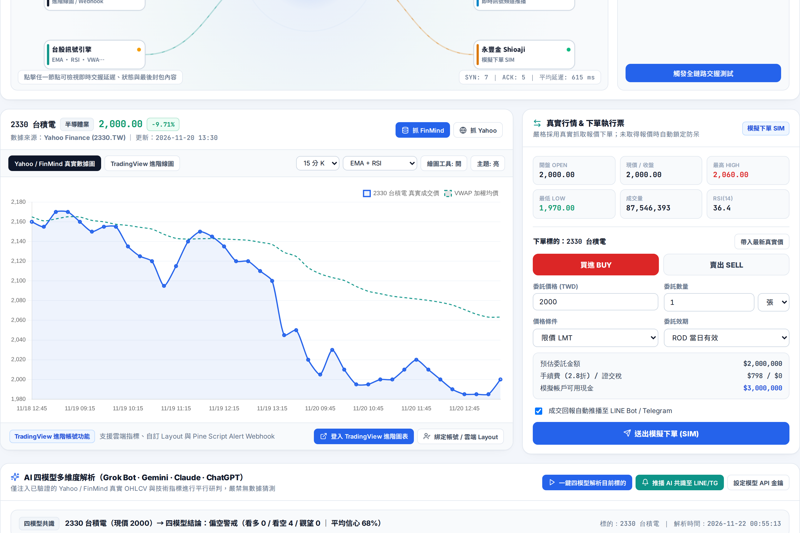
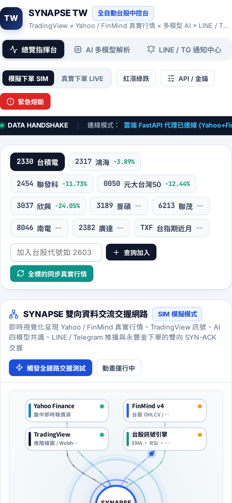

# SYNAPSE TW · 全自動台股交易系統（TradingAutomatic）


**SYNAPSE TW** 是一套支援**雲端部署**與**單檔免安裝直接執行**的全自動台灣股市交易系統網頁版，整合 **雙向資料交流交握視覺化**、**TradingView 進階線圖與帳號串接**、**Yahoo Finance / FinMind 真實台股行情（嚴禁猜測）**、**Grok Bot / Gemini / Claude / ChatGPT 四模型 AI 解析**、**LINE Bot / Telegram 條列通知**，以及 **模擬下單（SIM）／真實下單（LIVE）安全切換**。

---

## 介面截圖（實機渲染）

### 1. 總覽指揮台：雙向資料交流交握網路 × TradingView × 真實報價下單
> 60fps 呈現 Yahoo Finance、FinMind v4、TradingView、台股訊號引擎、AI 四模型共識、LINE Bot、Telegram 與永豐金 Shioaji 之間的即時 `SYN-ACK` 雙向交握封包。


### 2. AI 四模型多維度解析（Grok · Gemini · Claude · ChatGPT）× 台股自動訊號掃描
> 僅注入已驗證的真實 OHLCV、EMA(5/12)、RSI(14)、VWAP 指標進行四模型平行研判與共識彙整，並完整呈現 **股票代號＋中文名稱**。



### 3. LINE Bot & Telegram 條列通知中心
> 支援 LINE Messaging API Push 與 Telegram Bot，訊息採條列對齊格式，完整顯示每檔標的之**股票代號、中文名稱、現價、漲跌幅、RSI 與觸發依據**。


### 4. RWD 行動裝置自適應介面（390px 零水平溢出）
> 手機解析度下交握拓撲自動切換為 3 層不重疊排版，所有圖表、卡片與表格均嚴格防溢出。

<p align="center">
  
</p>

---

## 六大核心功能

| 模組 | 說明 |
| :--- | :--- |
| **1. 雙向資料交握視覺化 & RWD** | 高解析 Canvas 60fps 雙向 `SYN → ACK` 封包、旋轉交握環與節點即時檢視器；桌面／平板／手機零溢出自適應，並支援台股「紅漲綠跌／國際綠漲紅跌」切換。 |
| **2. TradingView 進階線圖與帳號登入** | 內嵌 TradingView 即時線圖（支援多週期、EMA/RSI、MACD/布林、VWAP、KD、繪圖工具列與亮暗主題）；提供「登入 TradingView 進階圖表」與自訂雲端 Layout 網址綁定，並自動產生 Pine Script v5 Webhook 腳本。 |
| **3. LINE Bot & Telegram 條列推播** | 透過後端 `/api/v1/notify/broadcast` 轉發免除瀏覽器 CORS 限制；單筆訊號、全市場彙整、AI 共識報告與成交回報皆完整條列**股票代號與中文名稱**。 |
| **4. 四模型 AI 輔助解析** | 平行掛載 **Grok Bot (xAI)**、**Gemini (Google)**、**Claude (Anthropic)**、**ChatGPT (OpenAI)**，輸出各模型看多／觀望／看空評級、信心分數、支撐壓力與風控提醒；未設定 API Key 時自動以真實數據本地量化摘要透明運作，絕不造假。 |
| **5. Yahoo & FinMind 真實台股行情** | 預設優先透過雲端後端代理抓取 **Yahoo Finance**（15m 盤中）與 **FinMind v4**（`TaiwanStockPrice` / `TaiwanFuturesDaily` / `TaiwanStockInfo`），嚴禁任何假報價猜測；支援輸入任意 4～6 碼台股代號即時驗證官方中文名稱並加入監控。 |
| **6. 模擬下單 (SIM) / 真實下單 (LIVE)** | 預設為模擬盤 SIM（依真實同步報價紙上撮合，計算台股 2.8 折手續費與證交稅，記錄 SQLite 稽核日誌並匯出 CSV）；切換至真實盤 LIVE 須通過雙重安全檢核，並要求伺服器已配置永豐金 Shioaji 金鑰與 `Sinopac.pfx` 憑證，否則自動阻斷。 |

---

## 快速開始（支援直接執行與一鍵打包）

### 方式一：直接下載 GitHub Release 執行（最簡單、免裝 Python）
前往本專案的 **[Releases 頁面](https://github.com/LHSheng-404/TradingAutomatic/releases)** 下載最新版本：

- **Linux（免安裝單檔直接執行）**：
  ```bash
  chmod +x SYNAPSE-TW-v1.0.0-linux-x64
  ./SYNAPSE-TW-v1.0.0-linux-x64
  ```
- **Windows / macOS（自動建置或使用可攜版）**：
  - 若下載 `SYNAPSE-TW-v1.0.0-windows-x64.exe`：直接雙擊執行即可自動開啟瀏覽器。
  - 若下載 `SYNAPSE-TW-v1.0.0-portable.zip`：解壓縮後雙擊 `start.bat`（Windows）或執行 `./start.sh`（macOS / Linux）。

啟動後瀏覽器會自動開啟 `http://127.0.0.1:8000`（如欲不開啟瀏覽器或自訂埠號，可加參數 `--port 8080 --no-browser`）。

---

### 方式二：原始碼一鍵啟動

```bash
git clone https://github.com/LHSheng-404/TradingAutomatic.git
cd TradingAutomatic
```

- **Linux / macOS**：
  ```bash
  ./start.sh
  ```
- **Windows**：
  雙擊執行 `start.bat`，或於命令提示字元執行：
  ```cmd
  start.bat
  ```

---

### 方式三：一鍵打包發行版（產出單檔執行檔 + Portable ZIP/TAR.GZ）

本專案內建跨平台一鍵打包腳本 [`package.py`](package.py)：

```bash
pip install -r requirements.txt pyinstaller
python3 package.py --version v1.0.0
```

執行完成後會在 `dist/` 目錄自動產出：
1. `SYNAPSE-TW-v1.0.0-<os>-<arch>`（免安裝單一可執行檔，已內嵌 `index.html`）
2. `SYNAPSE-TW-v1.0.0-portable.zip` 與 `.tar.gz`（跨平台可攜包）
3. `SHA256SUMS.txt`（完整性校驗檔）

> 專案同時包含 GitHub Actions 自動發布管線 [`.github/workflows/release.yml`](.github/workflows/release.yml)，每次推送 `v*` 標籤時會自動於雲端同步編譯 **Windows `.exe`、macOS、Linux** 三平台直出執行檔並上傳至 Release。

---

### 方式四：雲端一鍵部署

#### A. Render.com 全棧部署（推薦，Yahoo / FinMind / AI / LINE / Shioaji 全支援）
1. 登入 [Render.com](https://render.com) → **New +** → **Blueprint**。
2. 選擇 `LHSheng-404/TradingAutomatic`（自動讀取 [`render.yaml`](render.yaml)）。
3. 於 Environment Variables 填入您的金鑰（見下方環境變數說明）即可取得 HTTPS 公開網址。

#### B. Docker 容器部署
```bash
cp .env.example .env
# 編輯 .env 填入您的 API 金鑰
docker build -t synapse-tw .
docker run -d -p 8000:8000 --env-file .env --name synapse-tw synapse-tw
```

#### C. 純靜態前端部署（Cloudflare Pages / Vercel / GitHub Pages）
- 本專案已內建 [`.github/workflows/pages.yml`](.github/workflows/pages.yml) 與 [`vercel.json`](vercel.json)，純靜態前端預設直連 FinMind v4 (`Access-Control-Allow-Origin: *`) 真實台股資料；亦可於網頁內「雲端部署與腳本」頁籤填入已部署的 FastAPI 後端網址，立即啟用 Yahoo 盤中代理、AI 代理與 LINE 推播。

---

## 詳細使用指南與環境設定

複製 `.env.example` 為 `.env`（切勿將 `.env` 或 `.pfx` 憑證上傳至 Git）：

```env
# 預設模擬盤 SIM；完成實盤風控測試與憑證驗證後方可改為 LIVE
TRADING_MODE=SIM
CHECK_TV_IP=true
TV_WEBHOOK_SECRET=SYNAPSE_TV_SECRET_2026

# FinMind API v4 Token（選填，多組請以逗號分隔輪替）
FINMIND_TOKENS=

# 四模型 AI API 金鑰（可填入任一或全部模型）
XAI_API_KEY=
GROK_MODEL=grok-3-mini
GEMINI_API_KEY=
GEMINI_MODEL=gemini-2.5-flash
ANTHROPIC_API_KEY=
CLAUDE_MODEL=claude-sonnet-4-20250514
OPENAI_API_KEY=
OPENAI_MODEL=gpt-4o-mini

# LINE Messaging API Bot & Telegram Bot
LINE_CHANNEL_ACCESS_TOKEN=
LINE_TARGET_ID=
TELEGRAM_BOT_TOKEN=
TELEGRAM_CHAT_ID=

# 永豐金 Shioaji 實盤設定（僅 LIVE 模式需要）
SHIOAJI_API_KEY=
SHIOAJI_SECRET_KEY=
SHIOAJI_CA_PATH=./certs/Sinopac.pfx
SHIOAJI_CA_PASS=
```

### 各模組串接說明
1. **TradingView 帳號與進階快訊串接**
   - 點擊圖表區「**登入 TradingView 進階圖表**」即可在您的已登入帳號開啟同步台股標的。
   - 若擁有 Essential / Plus / Premium 方案，可點擊「**綁定帳號／雲端 Layout**」貼上專屬圖表網址，並至「**雲端部署與腳本**」複製自動產生的 Pine Script v5 腳本，於 TradingView 建立快訊並將 Webhook URL 設為 `https://<您的網域>/api/v1/webhook/tv`。
2. **LINE Bot & Telegram 設定**
   - **LINE Bot**：至 [LINE Developers](https://developers.line.biz/) 建立 Messaging API Channel，取得 `Channel Access Token` 與接收對象的 `User ID (U...)` 或 `Group ID (C...)`。
   - **Telegram Bot**：向 `@BotFather` 申請 `Bot Token`，並取得目標聊天室或頻道的 `Chat ID`。
3. **模擬下單（SIM）與真實下單（LIVE）切換**
   - 頂部工具列可即時切換 **模擬下單 SIM** / **真實下單 LIVE**，隨時可按「**緊急熔斷**」立即鎖定所有手動與自動委託。
   - 若要啟用永豐金 Shioaji 實盤，請於 `requirements.txt` 取消 `shioaji` 註解並掛載有效的 `Sinopac.pfx` 憑證。

---

## 專案目錄結構

```text
TradingAutomatic/
├── index.html                   # 單頁響應式前端（雙向交握拓撲、TradingView、AI、LINE/TG、下單票）
├── server.py                    # FastAPI 雲端後端（Yahoo/FinMind、4模型 AI、LINE/TG、Shioaji、Webhook）
├── launcher.py                  # 一鍵啟動與 PyInstaller 單檔執行檔入口
├── package.py                   # 跨平台一鍵打包腳本（產出單檔執行檔 + Portable ZIP/TAR.GZ + SHA256）
├── start.sh                     # Linux / macOS 一鍵建立環境並啟動腳本
├── start.bat                    # Windows 雙擊一鍵啟動腳本
├── requirements.txt             # Python 套件清單
├── Dockerfile                   # Docker 容器映像檔設定
├── render.yaml                  # Render.com 一鍵部署藍圖
├── vercel.json                  # Vercel 靜態前端設定
├── .env.example                 # 環境變數範本
├── .github/workflows/
│   ├── release.yml              # GitHub Actions 多平台自動打包發布 Release
│   └── pages.yml                # GitHub Pages 靜態網頁自動部署
└── docs/screenshots/            # 實機渲染介面截圖
```

---

## 風險聲明

本專案僅供量化交易系統開發、技術研究與模擬回測參考，不構成任何投資建議。金融市場交易具高度風險，切換至 **真實下單 LIVE** 模式前請務必先於 **模擬盤 SIM** 完整測試策略、Webhook 驗證與停損風控規則，使用者須自行承擔一切實盤交易損益與責任。
