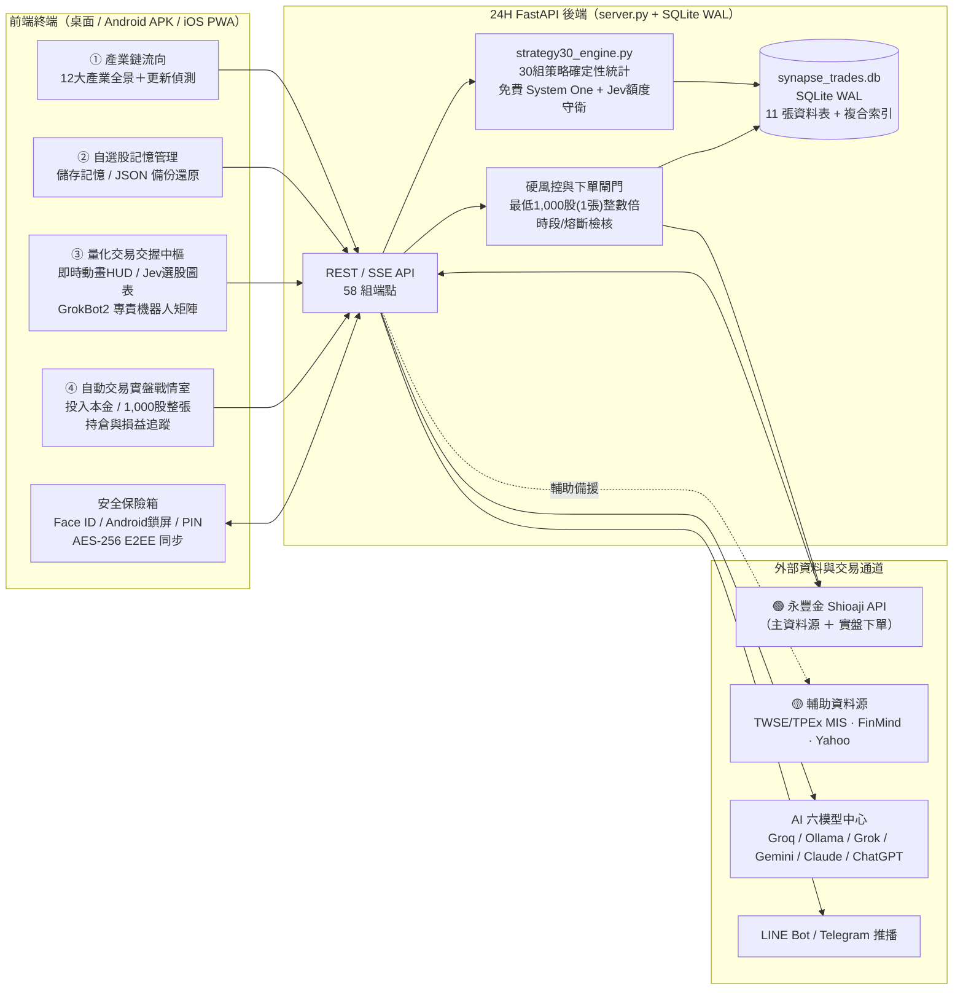
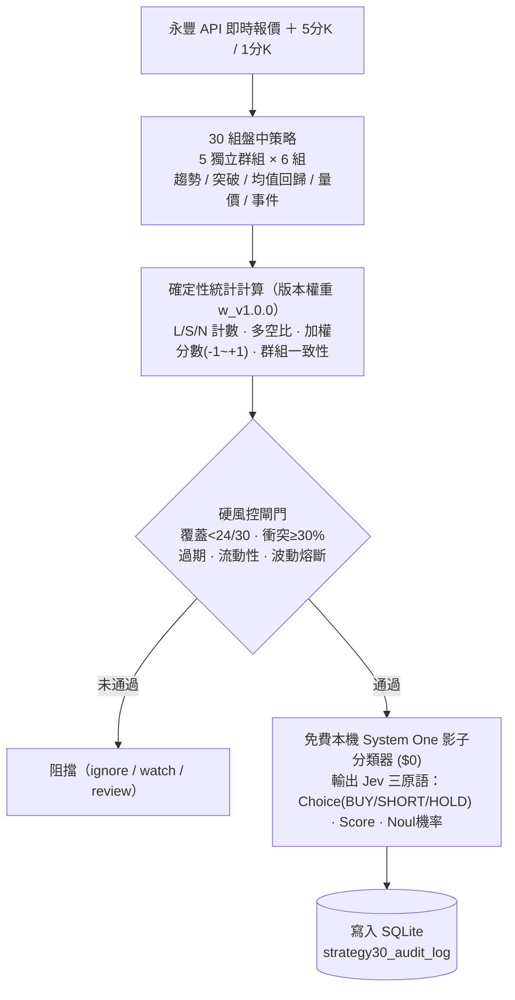

# SHL TW 全自動台股量化交易系統 — 完整系統架構與規格說明書

> **系統版本**：`v3.26.0`（Android `versionCode 3260` / iOS `build 3260`）  
> **程式碼倉庫**：`https://github.com/LHSheng-404/TradingAutomatic`  
> **靜態網頁 / PWA 入口**：`https://lhsheng-404.github.io/TradingAutomatic/`  
> **最後整理日期**：2026-11-26

---

## 1. 系統總覽與核心設計原則

**SHL TW** 是一套專為台股盤中自動化量化交易打造的全平台系統，支援 **Windows / macOS / Linux 桌面執行檔**、**Android 原生 APK**、**iOS IPA / Safari PWA** 與 **24H 雲端後端（Render / Docker）**。

### 六大不可違反之核心原則
1. **真實數據優先**：盤中報價、逐筆與 5分K／1分K 嚴格以 **永豐金 Shioaji API** 為主連線，TWSE／TPEx MIS、FinMind、Yahoo 明確列為輔助備援資料源，嚴禁虛構假價格。
2. **買賣最低單位硬鎖定 1,000 股（1 張）整數倍**：前後端全鏈路（手動下單、`executeOrder()`、`SHL_WAR` 量化策略、回測預設、`POST /api/v1/orders/place`）強制攔截任何低於 1,000 股或非 1,000 股倍數之零股委託，永豐實盤固定使用 `StockOrderLot.Common`。
3. **本金輸入後自主複利滾動**：使用者僅需於「自動交易實盤戰情室」設定投入本金（TWD），後續系統自動依可用現金（本金 ＋ 已實現獲利）計算可負擔整張張數；若資金不足 1 張（1,000 股）則自動略過，絕不降級買零股。
4. **嚴格 \$0 免費原則與 Jev 額度守衛**：30 組盤中策略與 System One 影子分類器預設 100% 於本機確定性運行（費用 **\$0.00**）；若外部 Jev 超出每日免費額度（6 次／UTC 日），立即停用外部呼叫並顯示「待 08:00 台北時間更新」，絕不自動扣款。
5. **硬風控絕對優先**：任何 AI 或 System One 分類器僅能在確定性程式計算後的受控選項內做分類，絕不可繞過硬風控（覆蓋率不足、多空衝突、流動性不足、波動熔斷、單日虧損熔斷、緊急熔斷 Kill Switch）或自行決定槓桿。
6. **主畫面極簡聚焦（Minimal Quant Desk）**：主頁僅常駐四大核心區塊（產業鏈流向、自選股記憶管理、量化自動交易交握中樞、自動交易實盤戰情室），技術線圖全面轉為內部量化引擎自動計算，並保留進階展開開關。

---

## 2. 整體系統架構圖



---

## 3. 專案目錄與檔案結構

| 檔案 / 目錄 | 用途與職責 |
|---|---|
| `index.html` | 單檔全功能響應式前端（桌面＋手機 PWA＋Android/iOS WebView 共用），內含四大主頁核心、交易中樞動畫 HUD、Jev 選股圖表、量化作戰室、回測與對帳復盤 |
| `server.py` | FastAPI 後端主程式（`v3.26.0`），提供永豐 Shioaji 串接、全市場排行、5分K/1分K、30 策略評估、下單閘門、AI 代理、LINE/TG 推播與 E2EE 雲端同步 |
| `strategy30_engine.py` | 30 組盤中策略確定性統計引擎（5 大獨立群組 × 6 組）、硬風控阻擋器、免費本機 System One 影子分類器、Jev 三原語輸出與 Jev 每日免費額度守衛 |
| `launcher.py` | 桌面單檔啟動器（支援 PyInstaller 打包為 Windows `.exe` / macOS / Linux 執行檔），負責自動啟動本機後端、開瀏覽器與關閉時乾淨結束程序 |
| `sw.js` / `manifest.webmanifest` | PWA Service Worker（`synapse-tw-shell-v3.26.0`）與安裝清單，支援 iOS/Android 加入主畫面 |
| `mobile/android/` | Android 原生 WebView 封裝（Gradle `versionCode 3260`，內建 `SHLAndroidAuth` 系統鎖屏／生物辨識橋接與生命週期清理） |
| `mobile/ios/` | iOS XcodeGen 專案設定（`MARKETING_VERSION 3.26.0` / `CURRENT_PROJECT_VERSION 3260`） |
| `render.yaml` / `Dockerfile` | 24H 雲端後端一鍵部署設定（自動產生 `SHL_ACCESS_PASSWORD` 防未授權存取） |
| `.github/workflows/` | 自動化 CI/CD：GitHub Pages 部署、多平台執行檔＋APK＋IPA Release 建置、台股盤中雲端 Keep-Alive 保活 |
| `package.py` / `start.bat` / `start.sh` | 跨平台打包腳本與本機一鍵啟動腳本 |
| `synapse_trades.db` | SQLite WAL 本地資料庫（自動執行 Migration v1～v3） |
| `處理框架.md` | 每次改版前先確認根因、架構規劃與實測驗收數據之標準作業文件 |

---

## 4. 主畫面四大精簡核心模組（`index.html`）

### ① 產業鏈資金流向（`#shlCapitalFlowSuite`）
- 支援 **排行／輪動／熱力圖／12 大產業全景** 切換。
- 補齊台灣 12 大產業鏈共 **39 檔**核心成分股中文對照（`window.SHL_CHAINS_12`、`window.SHL_CHAIN_ZH_NAMES`），全面顯示 **`股票代號 ＋ 中文名稱 ＋ 漲跌幅`**。
- 內建 **「🔄 刷新產業鏈・偵測更新」** 按鈕，即時比對前次現價並以金色亮框標示剛更新標的與更新檔數。

### ② 自選股記憶管理（`.watchlist-bar` ＋ `window.SHL_WATCHLIST_MEM`）
- 支援代號／中文查詢加入、盤中 1～30 秒即時刷新、截圖匯入群組與鎖屏看盤。
- 內建完整備份級記憶功能：
  - **💾 儲存記憶**：即時寫入本機 `localStorage`（含專屬防遺失鍵 `shl_watchlist_memory_v1`）並自動推送至雲端 E2EE 保險箱。
  - **⬇️ 備份匯出**：匯出 `shl-watchlist-backup-YYYYMMDD.json`（含自選股、自訂群組、投入本金）。
  - **⬆️ 匯入還原**：讀取備份 JSON 一鍵完整還原並同步全畫面。

### ③ 量化自動交易交握中樞（`#diagHandshakeCard`）
- **即時動畫 HUD（`#quantLiveHubHud` ＋ `window.SHL_TRADE_HUD`）**：
  - **即時市場情緒指標（0–100）**：依永豐實盤漲跌家數與診斷方向即時驅動指針（恐慌偏空／觀望中性／貪婪偏多）。
  - **5 階段下單流程動畫**：`① 永豐報價 → ② 分K價量 → ③ 情緒判定 → ④ 整張風控 → ⑤ 觀望／成交`。任何買賣觸發即刻亮紅（買進）或亮綠（賣出／現沖）脈衝閃動，並於 `#handshakeCanvas` 發射光束與浮動成交標籤；未觸發時呈現乾淨「⚪ 觀望監控中」雷達。
  - **連線狀態與手機快速解鎖**：明確區分「🟢 永豐金 Shioaji API 主連線」與「輔助資料源」，並提供一鍵「📱 快速解鎖（Face ID / PIN）」。
- **真實掃描母體（無 12 筆截斷上限）**：
  - 全市場（含 ETF 排行，最多 **50 檔**）
  - 全個股（不含 ETF，最多 **50 檔**）
  - 12 大產業鏈（39 檔）＋ 全部自選股（最高 **60 檔**）
  - 全部自選股 / 手動勾選多檔
  - 採 **8 檔分批並發抓取** 5分K＋1分K，確保手機端流暢不卡頓。
- **Grok Bot 2.0 風格專責高效機器人矩陣（`#grokBotPlatformMatrix`）**：
  - 🔴 **台股多方順勢 Bot**（永豐 Shioaji API · 最低 1,000 股）
  - 🟢 **台股現沖先賣 Bot**（永豐 Shioaji API · 13:25 強制回補）
  - 🛡️ **硬風控＆日虧損熔斷守護 Bot**（日虧 `-2%` 停機 · 嚴禁零股 · `$0` 免費）
- **Jev System One 快速選股視覺化圖表（`#jevScreenerCanvas` ＋ `window.SHL_JEV_CHART`）**：
  - 支援 **「📊 多空強度排行圖」** 與 **「🎯 一致性×強度四象限共識矩陣」** 雙模式切換、**⚡ 15 秒極速輪詢（\$0）**。

### ④ 自動交易實盤戰情室（`#autoTradeWarDashboard` ＋ `window.SHL_AUTO_DASH`）
- 頂部內建 **「💰 投入本金 (TWD)」** 輸入與 **「套用本金・自主滾動交易」** 按鈕，即時顯示可用現金與總權益。
- 一鍵啟動全自動量化交易、SIM／LIVE 切換、即時持倉（含 SL／TP 追蹤與一鍵平倉）、買賣成交稽核、手續費月結折讓統計與 CSV 匯出。

> **內部量化引擎（預設收折）**：互動技術線圖（`#rawPriceChart`）、三竹看板（`#mitakeLiveBoard`）、永豐全市場訊號串流（`#shioajiSignalsDeck`）與 AI 六模型卡片均收折於 `#deskInternalModulesWrap`，所有技術指標於內部背景自動計算，底部可隨時點擊「🔧 展開進階」檢視。

---

## 5. 30 組盤中策略與 Jev System One 決策架構（`strategy30_engine.py`）



### 核心規則摘要
- **固定版本化權重**：`WEIGHT_VERSION = "w_v1.0.0"`、`PROMPT_VERSION = "s1_v1.0.0"`，盤中禁止任意竄改權重。
- **群組一致性**：需 ≥2 個獨立策略群組同向方可判定高一致性，避免同質策略重複計票。
- **Jev 免費額度守衛**：每日 UTC 00:00（台北 08:00）自動重置，預設 `daily_limit = 6`；一旦超額或觸發 `429/402`，立即熔斷外部 Jev 呼叫並全面由 `$0` 本機確定性引擎運作，透過 `GET /api/v1/strategy30/jev-quota` 即時監控。
- **實測效能**：單檔 30 組策略評估約 **0.73 ms**；28 檔批次評估約 **54.28 ms**。

---

## 6. 量化交易與資金風控規則（`SHL_WAR` ＋ `executeOrder`）

1. **最低單位與倍率**：
   - 前端 `executeOrder()` 與後端 `POST /api/v1/orders/place` 雙重驗證：`shares >= 1000` 且 `shares % 1000 == 0`。
   - 一律正規化為整張 `lots = shares / 1000`（`unit = "張"`）。
2. **自主複利張數計算（`computeAutoLots`）**：
   - `availCash`：SIM 模式取 `state.simCashTwd`（本金 ＋ 已實現損益）；LIVE 模式取 `initialCapitalTwd + realizedPnl`。
   - `maxAffordableLots = floor((availCash * maxLev) / (price * 1000 * 1.003))`。
   - 若 `maxAffordableLots < 1`（連 1 張 1,000 股都買不起）→ **直接略過，絕不下零股**。
   - 依單筆風險比例 `riskPct` 計算 `riskLots`，取 `min(riskLots, maxAffordableLots)`。
3. **雙向策略與現股當沖**：
   - **多單順勢買入**：SMC BOS+FVG 回測或 5分K／1分K 站上 VWAP ＋ EMA5 > EMA12 ＋ 帶量突破。
   - **空單現沖先賣（`現沖先賣`）**：跌破 VWAP ＋ EMA5 < EMA12 ＋ 帶量下殺，支援 1R 保本、Fib 0.382 移動停利與 13:25 尾盤強制回補。

---

## 7. 後端 REST / SSE API 完整端點清單（`server.py`）

| 模組分類 | 方法與路徑 | 說明 |
|---|---|---|
| **健康與連線狀態** | `GET /api/v1/health` | 回傳版本號（`3.26.0`）、永豐 API 主連線狀態、AI／推播就緒狀態 |
| | `GET /api/v1/mobile/info` | 回傳區網 IP、連線資訊與手機快速連線參數 |
| **永豐金 Shioaji** | `GET /api/v1/shioaji/status` | 查詢永豐金 SIM/LIVE Token、Pro HTTP 與主/輔助資料源狀態 |
| | `POST /api/v1/shioaji/configure` / `clear` / `test-token` | 設定、清除（防憑證流出）與測試永豐 API Token |
| | `GET` / `POST /api/v1/shioaji/mode` | 查詢與切換 SIM／LIVE 交易環境 |
| | `GET /api/v1/shioaji/snapshots` | 永豐即時多股報價快照 |
| | `GET /api/v1/shioaji/kbars/{symbol}` | 永豐真實 1分K／5分K／日K 資料 |
| | `POST /api/v1/shioaji/scanner/subscribe`、`GET .../events`、`.../stream` | 永豐全市場 13 規則即時訊號訂閱與 SSE 串流 |
| **市場行情與排行** | `GET /api/v1/market/rank` | 全市場（`all`）／全個股（`stocks`）／自訂（`custom`）多空強勢前 50 檔 |
| | `GET /api/v1/market/realtime`、`stock-search`、`breadth_contrib` | 多股即時報價、代號／中文搜尋、權值股大盤貢獻點數 |
| | `GET /api/v1/market/yahoo/{sym}`、`finmind/{id}`、`quant-history/{id}` | 輔助歷史 K 線、除權息與回測資料源 |
| **30 組策略 & Jev** | `POST /api/v1/strategy30/evaluate` | 高速評估最多 60 檔 × 30 組策略，回傳確定性統計、`jev_primitives` 與 `jev_quota` |
| | `GET /api/v1/strategy30/jev-quota`、`GET /api/v1/strategy30/audit` | 查詢 Jev 免費額度狀態與 SQLite 歷史稽核紀錄 |
| **診斷交握網路** | `POST /api/v1/diagnostics/handshake/run` | 寫入 6 階段交易邏輯診斷紀錄 |
| | `GET /api/v1/diagnostics/handshake/history`、`stats` | 複合索引查詢歷史診斷明細與勝率／延遲統計 |
| **下單與 Webhook** | `POST /api/v1/orders/place` | 統一下單閘門（強制 ≥1,000 股整張倍數、SIM 撮合 / LIVE 永豐送單） |
| | `GET /api/v1/orders/history`、`POST /api/v1/webhook/tv` | 委託紀錄查詢與 TradingView Webhook 自動接單 |
| **AI 六模型中心** | `POST /api/v1/ai/analyze`、`agent/orchestrate`、`test-all` | 六模型平行分析（含 402/429 熔斷冷卻、60s 快取與 12s 逾時保護） |
| **安全同步與裝置** | `POST /api/v1/vault/{push,pull,meta}`、`account/{login,sync/*}` | AES-256 端對端加密保險箱與跨裝置無感同步 |
| | `POST /api/v1/device/{register,pair/create,pair/claim,unlink}` | 電腦與手機（iOS/Android）配對與裝置管理 |
| **通知推播** | `POST /api/v1/notify/broadcast`、`/api/v1/telegram/*` | LINE Bot 與 Telegram 綁定及條列式訊號推播 |

---

## 8. 資料庫結構（SQLite WAL · `synapse_trades.db`）

系統啟動時自動啟用 `PRAGMA journal_mode=WAL` 與 `schema_migrations` 版本管理（v1～v3），共 **11 張資料表**：

1. `trade_orders`：所有 SIM／LIVE 整張委託與成交稽核紀錄（含手續費、證交稅、來源與 `owner_id`）。
2. `decision_handshake_runs`：每次多檔 5分K／1分K 診斷掃描批次彙總。
3. `decision_handshake_items`：每檔標的之方向、策略明細、AI 價量評分與下單結果（建有複合索引防慢查詢）。
4. `strategy30_audit_log`：30 組策略完整稽核快照（權重版、多空比、加權分、群組一致性、硬風控阻擋、System One 品質與級別、延遲 ms，建有 3 組複合索引）。
5. `encrypted_vault_sync`：端對端加密（E2EE）使用者保險箱密文（伺服器無法解密明文金鑰）。
6. `remote_accounts`：跨裝置遠端帳號同步資料表。
7. `device_owners` / `device_registry` / `device_pair_codes`：多裝置配對與權限控管。
8. `telegram_bindings`：Telegram Bot 綁定狀態。
9. `schema_migrations`：資料庫遷移版本紀錄。

---

## 9. 資安防護與手機端（iOS / Android）快速登入

- **API 金鑰防流出**：
  - 永豐 SIM／LIVE Token 獨立比對、停用瀏覽器自動填入，支援單獨清除與「一鍵清除全部 Token」（同步清除 `localStorage` 與後端快取）。
  - Groq / FinMind 金鑰全面改走 HTTP Header，嚴禁置於 URL Query String；後端回應附加 `Referrer-Policy: no-referrer`、`X-Content-Type-Options: nosniff`、`Cache-Control: no-store`。
  - Render 雲端部署透過 `render.yaml` 自動產生 `SHL_ACCESS_PASSWORD`，未經授權無法存取雲端 API。
- **手機端（iOS / Android）最佳化**：
  - 啟動載入進度條（0%→100%，仿永豐 APP 體驗），解鎖後自動靜默拉取伺服器設定（`pullFromBackendSilent`）免手動重設。
  - 支援 **Face ID / 指紋 / Android `KeyguardManager` / 手機鎖屏數字 PIN 鍵盤（`#vaultPinKeypad`）** 快速解鎖。
  - 完整支援 iOS Safe Area（`env(safe-area-inset-*)`）、觸控按鈕 ≥38–44px、手機端單欄自適應與正常關閉／切回前景自動重連機制。

---

## 10. 快速啟動與部署方式

### 方式 A：本機桌面啟動
```bash
# 1. 安裝依賴
pip install -r requirements.txt

# 2. 啟動系統（自動開啟瀏覽器並支援同區網手機連線）
python3 launcher.py
```
或直接於 [GitHub Releases](https://github.com/LHSheng-404/TradingAutomatic/releases) 下載對應平台單檔執行檔（`windows-x64.exe`、`macos-arm64`、`linux-x64`、`android.apk`、`ios-unsigned.ipa`）。

### 方式 B：24H 雲端後端（電腦免開機，手機隨時連線）
1. 將倉庫匯入 Render（自動讀取 `render.yaml` 與 `Dockerfile`），環境變數自動生成 `SHL_ACCESS_PASSWORD`，並可填入 `SHIOAJI_API_KEY`、`SHIOAJI_SECRET_KEY`。
2. 啟用 `.github/workflows/cloud-keepalive.yml` 於台股交易時段自動保活。
3. 手機開啟 `https://lhsheng-404.github.io/TradingAutomatic/?backend=你的Render網址`，一鍵完成 24H 雲端連線與自動同步。
