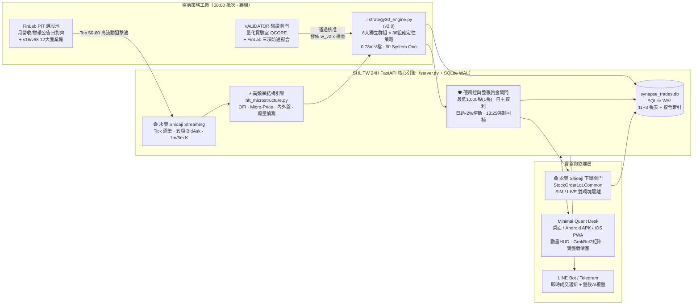

# 台股量化交易系統整合規格書（TW-Quant × SHL TW 融合版）

* **文件版本**：`v2.0`（基於 `SHL TW v3.26.0` 生產級架構擴充）
* **架構核心**：GROK BOT 2.0 八大代理閉環 × `SHL TW` 高速量化交握中樞
* **整合來源**：`SHL TW v3.26.0`（數據／下單／30策略引擎主幹） × FinLab（PIT 選股與三項驗證） × 量化策略實驗室（Alorse 策略與台股精算回測） × 台股分析系統 v68（盤口微結構與五檔） × 釣魚選股 v16（產業鏈圖譜）
* **適用市場**：台灣證券交易所（TWSE）與櫃檯買賣中心（TPEx）現股與現股當沖市場

---

## 1. 整合願景與六大不可違反鐵律（承襲 SHL TW）

本規格書以 `SHL TW` 現有的 FastAPI 後端（`server.py`）、30 組策略引擎（`strategy30_engine.py`）與 SQLite WAL 資料庫（`synapse_trades.db`）為核心骨幹，將盤前多因子選股、毫秒級盤口微結構與嚴格防過擬合驗證無縫嵌入，並嚴格遵守以下六大鐵律：

1. **永豐金 Shioaji 真實數據主連線優先**：盤中即時報價、逐筆 Tick、五檔委託（Bid/Ask）與 1分K／5分K 一律以 **Shioaji API** 為主通道；TWSE／TPEx MIS、FinMind、MOPS 與 Yahoo 僅作為盤前基本面／籌碼或斷線備援，嚴禁虛構假價格。
2. **買賣最低單位硬鎖定 $1,000$ 股（$1$ 張）整數倍**：前後端全鏈路（`executeOrder()`、`SHL_WAR`、回測引擎、`POST /api/v1/orders/place`）強制攔截任何低於 $1,000$ 股或非 $1,000$ 股倍數之零股委託；永豐實盤固定使用 `StockOrderLot.Common`，**全面移除零股拆單邏輯**。
3. **本金輸入後自主複利滾動**：使用者設定投入本金（TWD）後，系統依可用現金（本金 $+$ 已實現損益）自動計算可負擔整張數；若資金不足 $1$ 張則自動略過，絕不降級買零股。
4. **嚴格 $\$0$ 本機確定性運行與 Jev 額度守衛**：高頻與盤中核心策略（含 30 組策略與 System One 影子分類器）100% 於本機確定性運行（單檔 $< 1\text{ ms}$，費用 $\$0.00$）；外部 Jev 呼叫受每日免費額度（$6$ 次／UTC 日，台北時間 `08:00` 重置）守衛，超額即刻熔斷不扣款。
5. **硬風控絕對優先**：任何 AI 模型或分類器僅能在確定性程式計算後的受控選項內做分類，嚴禁繞過硬風控（覆蓋率不足、多空衝突、流動性不足、波動熔斷、單日虧損 $-2\%$ 熔斷、13:25 當沖強制回補、Kill Switch）。
6. **主畫面極簡聚焦（Minimal Quant Desk）**：前端維持四大核心區塊（產業鏈流向、自選股記憶管理、量化自動交易交握中樞、自動交易實盤戰情室），高頻盤口運算與技術指標全數收斂至背景引擎自動執行。

---

## 2. 系統總體架構圖（SHL TW 強化整合版）



---

## 3. SHL TW 數據通道與整張下單閘門規格

### 3.1 資料來源分級與毫秒級串流機制
| 資料層級 | 主要來源（Primary） | 備援來源（Auxiliary） | 延遲與更新頻率 |
| :--- | :--- | :--- | :--- |
| **高頻盤口（Tick 逐筆／五檔 BidAsk）** | **永豐金 Shioaji Streaming API** | TWSE/TPEx MIS 輪詢 | 事件驅動（Event-Driven，目標 $< 50\text{ ms}$） |
| **盤中 K 線（1分K／5分K）** | **永豐金 Shioaji `kbars`**（8 檔並發抓取） | Yahoo Finance / MIS | 盤中即時聚合與每 15 秒批次刷新 |
| **全市場強弱排行（Top 50–60）** | **SHL TW `/api/v1/market/rank`** | 12 大產業鏈（39 檔）＋自選股 | 盤前鎖定＋盤中動態輪動更新 |
| **盤前基本面／籌碼（PIT 對齊）** | **FinMind API**（補齊公告日對齊） | 公開資訊觀測站（MOPS） | 交易日 `17:30`、營收每月 10 日、季報法規截止日 |

### 3.2 整張硬鎖定與自主複利資金計算（`POST /api/v1/orders/place`）
全系統強制套用 `SHL TW` 的雙重驗證與自主複利公式：
* **硬性防呆檢核**：下單股數 $Q$ 必須滿足 $Q \ge 1000$ 且 $Q \bmod 1000 = 0$，轉換為整張張數 $L = Q / 1000$，永豐實盤固定傳入 `StockOrderLot.Common`。
* **自主複利張數公式（`computeAutoLots`）**：
  $$\text{availCash} = \begin{cases} \text{simCashTwd} & \text{if SIM 模式} \\ \text{initialCapitalTwd} + \text{realizedPnl} & \text{if LIVE 模式} \end{cases}$$
  $$\text{maxAffordableLots} = \left\lfloor \frac{\text{availCash} \times \text{maxLev}}{P_{\text{entry}} \times 1000 \times 1.003} \right\rfloor$$
  若 $\text{maxAffordableLots} < 1$（連 $1$ 張 $1,000$ 股皆無法負擔），**直接略過該筆訊號，絕不下零股**。最終下單張數為：
  $$L_{\text{final}} = \min\left(\text{riskLots}, \text{maxAffordableLots}, L_{\text{max\_single}}\right)$$
  其中 $\text{riskLots}$ 依單筆最大風險比例 $R_{\text{trade}}$ 與停損距離（如 $1.5 \times ATR$ 或前波結構低點）反推。

### 3.3 台股升降單位（Tick Size）精準掛單
高頻下單對滑價極度敏感，下單閘門須將目標價依台股級距精準對齊，並支援「讓價 $1$ Tick 搶成交」或「掛內盤等待（Maker）」雙模式：
* $< 10$ 元：$0.01$ ｜ $10 \sim 50$ 元：$0.05$ ｜ $50 \sim 100$ 元：$0.10$ ｜ $100 \sim 500$ 元：$0.50$ ｜ $500 \sim 1,000$ 元：$1.00$ ｜ $\ge 1,000$ 元：$5.00$。

---

## 4. 強化版高頻／盤中量化交易策略引擎（核心升級）

為了將 `SHL TW` 原有的 1分K／5分K 交易提升至**亞秒級微結構感知的高頻／極短線量化系統**，本架構設計「**三層漏斗＋確定性共識＋雙向專責機器人**」機制：

### 4.1 第一層：盤前 PIT 高動能狙擊池（減少無效掃描）
高頻交易最忌諱在無量死魚股上浪費算力與承擔滑價。每日 `08:00` 執行 FinLab PIT 排名法，結合 `v16` 12 大產業鏈與 `v68` 33 題材輪動，篩選出當日 **Top 50–60 檔「高流動、高波動、強題材」狙擊池**，直接訂閱 Shioaji Streaming：
1. **流動性底線**：近 $5$ 日均成交金額 $\ge 1$ 億元新台幣、開盤前五檔價差（Spread）$\le 2\text{ Ticks}$。
2. **波動率門檻**：近 $10$ 日平均真實振幅（$ATR\%$）$\ge 2.5\%$，確保盤中具備足夠空間覆蓋當沖成本。
3. **PIT 動能與籌碼加權**：排除處置股（分盤交易）與全額交割股，優先納入法人連買 $\ge 2$ 日或族群處於「領先／轉強」象限之標的。

### 4.2 第二層：毫秒級盤口微結構引擎（`hft_microstructure.py`）
整合 `Shioaji Tick/BidAsk` 與 `台股分析系統 v68` 的盤口判讀，於記憶體 Ring Buffer 中即時計算四大高頻微結構特徵（不落盤、零延遲）：

1. **五檔委託流不平衡（Weighted Order Book Imbalance, $OBI_5$）**：
   給予靠近成交價的檔位更高權重（$w = [5, 4, 3, 2, 1]$），衡量買賣盤瞬間推力：
   $$OBI_5 = \frac{\sum_{k=1}^{5} w_k V_{\text{bid}, k} - \sum_{k=1}^{5} w_k V_{\text{ask}, k}}{\sum_{k=1}^{5} w_k \left(V_{\text{bid}, k} + V_{\text{ask}, k}\right)} \in [-1, +1]$$
   當 $OBI_5 > +0.35$ 且買一檔掛單量驟增時，判定為高頻多方主導。

2. **微價格偏移（Micro-Price Alpha）**：
   利用最佳買賣報價與掛單量推算「真實公允微價格」$P_{\text{micro}}$，提前 $1 \sim 3$ 秒預判下一個 Tick 的跳動方向：
   $$P_{\text{micro}} = \frac{P_{\text{bid}, 1} \cdot V_{\text{ask}, 1} + P_{\text{ask}, 1} \cdot V_{\text{bid}, 1}}{V_{\text{bid}, 1} + V_{\text{ask}, 1}}$$
   當 $P_{\text{micro}} - P_{\text{mid}} > 0.35 \times \text{Tick}$ 時，觸發向上突破預期訊號。

3. **短窗內外盤主動買賣比（Tick Aggressor Ratio, 10s / 30s）**：
   統計最近 $10$ 秒與 $30$ 秒內主動打穿賣一（外盤量 $V_{\text{outer}}$）與主動砸穿買一（內盤量 $V_{\text{inner}}$）之淨量比，偵測主力大單連續敲進（Sweep Order）。

4. **VWAP 動態偏離 Z-Score（$Z_{\text{VWAP}}$）**：
   $$Z_{\text{VWAP}} = \frac{P_t - \text{VWAP}_t}{\sigma_{\text{VWAP}, t}}$$
   用於區分「健康趨勢推進（$0.5 \le Z_{\text{VWAP}} \le 2.0$）」與「過度乖離極端區（$|Z_{\text{VWAP}}| > 2.5$，啟動高頻均值回歸或禁止追價）」。

### 4.3 第三層：`strategy30_engine.py` v2.0 確定性共識引擎
保留原本 `0.73 ms`/檔 的極速確定性架構與版本化權重（升級為 `WEIGHT_VERSION = "w_v2.0.0"`），將策略從 5 群組（30 組）擴充為 **6 大獨立群組 × 6 組 ＝ 36 組確定性策略**（完整融合 `SHL_WAR`、`Alorse` 與高頻微結構）：

| 策略群組 | 策略數 | 核心邏輯來源 | 代表高頻／盤中訊號 |
| :--- | :---: | :--- | :--- |
| **G1. 趨勢順勢群組** | 6 | `SHL_WAR` + `Alorse` | 1分K／5分K 站上 VWAP、$EMA_5 > EMA_{12}$、Supertrend 翻多 |
| **G2. 結構突破群組** | 6 | `SHL_WAR` + `Alorse` | SMC `BOS + FVG` 回測確認、開盤 15 分鐘區間突破（ORB）、TTM Squeeze 能量釋放 |
| **G3. 均值回歸群組** | 6 | `量化策略實驗室` | 布林通道極端回撤、$Z_{\text{VWAP}}$ 過度偏離反轉、RSI(6) 盤中背離 |
| **G4. 量價動能群組** | 6 | `SHL TW` + `v68` | 1分K 量能突增（$> 2.5 \times$ 均量）、量價齊揚、突破日內高點（HOD） |
| **G5. 事件與族群聯動** | 6 | `v16` + `v68` | 同產業鏈龍頭先漲帶動落後補漲（Lead-Lag 套利）、強勢族群 $RS$ 共振 |
| **G6. 高頻微結構群組（新增）** | 6 | `hft_microstructure.py` | $OBI_5$ 失衡、$P_{\text{micro}}$ 領先偏移、10 秒外盤大單連續掃貨（Sweep）、買賣價差收斂 |

* **共識放行門檻（硬風控前置）**：
  * 有效策略覆蓋率須 $\ge 80\%$（$\ge 29/36$ 組正常回傳）。
  * 多空衝突率須 $< 30\%$。
  * **跨群組一致性**：至少需 $\ge 2$ 個獨立群組同向，且 **G6（高頻微結構群組）不得與進場方向強烈背離**（防止「K線看似突破、實則主力在五檔倒貨」的假突破陷阱）。

### 4.4 Grok Bot 2.0 雙向高頻專責機器人與出場紀律
承襲並強化 `SHL TW` 的三組專責機器人矩陣：

1. **🔴 台股多方高頻順勢 Bot**：
   * **進場**：G1/G2/G4 共振偏多 $+$ G6 微結構確認（$OBI_5 > 0.25$ 且無大單壓盤）$+$ 距漲停價 $> 2\%$（防追高鎖死風險）。
   * **出場**：嚴格執行 **1R 保本機制**（帳面獲利達 $1 \times$ 初始風險即上移停損至成本 $+$ 稅費）、**Fib $0.382$ 移動停利**、或 G6 偵測到連續 30 秒內盤倒貨（$OBI_5 < -0.45$）即刻市價／讓價 1 Tick 搶出。
2. **🟢 台股現沖先賣（高頻空單）Bot**：
   * **進場**：跌破 VWAP $+$ $EMA_5 < EMA_{12}$ $+$ 帶量下殺 $+$ G6 確認內盤大單貫穿買一檔 $+$ 標的具備「現股當沖先賣」資格且距跌停價 $> 2.5\%$。
   * **強制回補紀律**：除 1R 保本與移動停利外，每日 **`13:20` 啟動尾盤分批回補預警，`13:25` 無條件強制市價／讓價平倉**，徹底杜絕現沖留倉違約交割風險。
3. **🛡️ 硬風控＆高頻熔斷守護 Bot（最高權限）**：
   * **單日虧損熔斷**：當日已實現 $+$ 未實現損益達投入本金之 **$-2.0\%$**，立即觸發 Kill Switch（取消所有未成交掛單、禁止開新倉）。
   * **高頻異常防呆（Anti-Flicker & Throttle）**：同一標的 $60$ 秒內禁止重複開倉（防洗盤來回打臉）；單檔連續停損 $2$ 次當天拉入冷卻黑名單；若 Shioaji 行情延遲超過 $1,500\text{ ms}$，自動暫停高頻開倉。

---

## 5. 八大代理（Eight Agents）與 SHL TW 系統對齊規格

| 代理節點 | 對應 SHL TW 模組／檔案 | 核心 API 端點（現有 ＋ 新增擴充） | 整合職責 |
| :--- | :--- | :--- | :--- |
| **1. ORCHESTRATOR** | `server.py` + `cloud-keepalive.yml` | `GET /api/v1/health`<br>`GET /api/v1/shioaji/status` | 驅動 `08:00` 盤前、`09:00–13:30` 高頻盤中、`13:25` 強平、`17:35` 盤後；控管 Jev 額度與 Shioaji 重連 |
| **2. UNIVERSE** | `pit_universe.py`（新增）<br>`#shlCapitalFlowSuite` | `GET /api/v1/market/rank`<br>`GET /api/v1/universe/pit-pool`（新增） | 結合 FinLab PIT 公告日對齊與 `v16` 12 大產業鏈，產出每日 50–60 檔高流動狙擊池 |
| **3. REGIME** | `server.py` 大盤廣度模組<br>`#quantLiveHubHud` | `GET /api/v1/market/breadth_contrib` | 計算權值股大盤貢獻點數、市場情緒指標（0–100）與族群輪動象限，動態調整多空曝險上限 |
| **4. SCORING** | `hft_microstructure.py`（新增）<br>`strategy30_engine.py` (v2.0) | `POST /api/v1/strategy30/evaluate`<br>`GET /api/v1/shioaji/scanner/stream` | 毫秒級計算 $OBI_5$、$P_{\text{micro}}$、$Z_{\text{VWAP}}$ 與 36 組確定性策略共識，輸出 Jev 三原語 |
| **5. RISK** | `server.py` 硬風控閘門<br>`SHL_WAR` (`computeAutoLots`) | `GET /api/v1/strategy30/jev-quota`<br>`POST /api/v1/risk/kill-switch`（新增） | 執行 $1,000$ 股整張鎖定、自主複利計算、$-2\%$ 日虧損熔斷、$60\text{ s}$ 防重複開倉與 $13:25$ 強制回補 |
| **6. EXECUTION** | `server.py` Shioaji 下單模組<br>`executeOrder()` | `POST /api/v1/orders/place`<br>`POST /api/v1/shioaji/mode` | 統一透過永豐 Shioaji `StockOrderLot.Common` 送出整張委託；嚴格隔離 SIM／LIVE 與 Tick 對齊 |
| **7. VALIDATOR** | `validator_gate.py`（新增）<br>移植自 `量化策略實驗室` | `POST /api/v1/validator/run-3step`（新增） | 盤後以真實當沖稅費＋滑價＋延遲模型執行三項驗證，決定是否核准新版 `WEIGHT_VERSION` |
| **8. CHIEF** | `server.py` AI 六模型中心<br>LINE / Telegram 推播 | `POST /api/v1/ai/analyze`<br>`POST /api/v1/notify/broadcast` | 每日盤後查詢 `strategy30_audit_log` 與 `trade_orders`，產出勝率、滑價誤差與策略偏移簡報 |

---

## 6. 高頻策略離線驗證閘門（`VALIDATOR` 防過擬合規格）

高頻與盤中當沖策略極易因「忽略手續費、忽略滑價、過度擬合特定行情」而在實盤失血。任何新策略或調整 `strategy30_engine.py` 權重前，必須在離線環境通過以下 **高頻三項驗證閘門**：

### 6.1 真實台股當沖成本與延遲懲罰模型
回測強制計入以下摩擦成本（以 $1,000$ 股整張為單位）：
* **券商手續費**：買賣各 $0.1425\% \times \text{實盤折數}$（預設 $2.8$ 折，最低 $20$ 元）。
* **證券交易稅**：現股當沖賣出 **$0.15\%$**；隔日沖／波段現股賣出 **$0.3\%$**；ETF 賣出 **$0.1\%$**。
* **高頻滑價與延遲懲罰（Latency & Slippage Penalty）**：
  * 假設訊號觸發至永豐撮合存在 $100\text{ ms} \sim 300\text{ ms}$ 網路與佇列延遲，回測強制施加 **單邊至少 $1 \sim 2\text{ Ticks}$ 之不利滑價**。
  * 若目標價觸及漲停或跌停鎖死，強制判定無法成交。

### 6.2 強制三項檢核表（全數通過始可升級 `WEIGHT_VERSION`）
1. **鄰近參數高原檢核（2D 熱力圖）**：檢驗關鍵參數（如 $OBI_5$ 門檻、$Z_{\text{VWAP}}$ 倍數、停損 $ATR$ 倍數）周圍 $3 \times 3$ 鄰域之夏普比率，須為「穩定高原」而非單一孤立尖峰。
2. **前後期樣本外切分（Walk-Forward IS vs. OOS）**：依時間切分樣本內（$70\%$）與樣本外（$30\%$），要求樣本外實得期望值 $> 0$ 且 $\text{Sharpe}_{\text{OOS}} \ge 0.6 \times \text{Sharpe}_{\text{IS}}$。
3. **跨標的與不同市況穩健性（多股批次矩陣）**：須在「多頭趨勢日、空頭下殺日、狹幅盤整日」三種大盤 Regime 下，跨至少 $30$ 檔狙擊池標的保持正獲利因子（$\text{Profit Factor} \ge 1.3$），且單日最大回撤不觸發頻繁熔斷。

---

## 7. 資料庫擴充與專案目錄整合（基於 `TradingAutomatic`）

### 7.1 `synapse_trades.db`（SQLite WAL）擴充規劃
在 `SHL TW` 原有 11 張資料表基礎上，透過 `schema_migrations` 升級至 **v4**，新增 3 張輕量級資料表（盤中微結構保留於記憶體，僅關鍵決策與盤後統計落盤，維持毫秒級寫入效能）：
1. `pit_daily_universe`：紀錄每日 `08:00` 產出的 Top 50–60 狙擊池、PIT 分數、產業鏈標籤與當日流動性門檻。
2. `hft_execution_metrics`：紀錄每筆整張委託之「理論觸發價 vs. 永豐實際成交價」滑價（Ticks）、API 下單往返延遲（ms）與當時 $OBI_5$ 快照，供 `CHIEF` 追蹤執行品質。
3. `validator_release_log`：紀錄每次 `WEIGHT_VERSION` 變更的 3 項驗證分數、OOS 夏普值與核准時間。

### 7.2 專案目錄擴充結構
直接延續現有 `LHSheng-404/TradingAutomatic` 倉庫結構，採低侵入式模組擴充：
```text
TradingAutomatic/
├── index.html                  # 現有 SHL TW 單檔前端（HUD 新增 OBI5 / 滑價延遲監控條）
├── server.py                   # 現有 FastAPI 主程式（掛載新模組與 Shioaji Tick/BidAsk 回呼）
├── strategy30_engine.py        # 升級至 v2.0（擴充 G6 高頻微結構群組，維持 < 1ms/檔）
├── hft_microstructure.py       # [新增] 記憶體 Ring Buffer、OBI5、Micro-Price、內外盤即時計算
├── pit_universe.py             # [新增] 盤前 FinLab PIT 排名選股 + 12大產業鏈整合
├── validator_gate.py           # [新增] 移植量化實驗室 QCORE + 當沖成本 + 三項防過擬合檢核
├── synapse_trades.db           # SQLite WAL（Migration 升級至 v4）
├── launcher.py / Dockerfile / render.yaml
└── docs/
    └── tw_quant_system_integration_spec.md
```

---

## 8. 分階段落地實作路線圖

### Phase 1：高頻微結構感知接入（第 1–2 週）
* 在 `server.py` 啟用 Shioaji `quote.subscribe` 訂閱 `Tick` 與 `BidAsk`（五檔），寫入新增的 `hft_microstructure.py` 記憶體環狀緩衝區。
* 將 `strategy30_engine.py` 由 5 群組（30 組）升級為 6 群組（36 組，`w_v2.0.0`），加入 **G6 高頻微結構群組**作為進場濾網與假突破擋板。
* 在前端 `#quantLiveHubHud` 新增極簡「五檔失衡 $OBI_5$ 與延遲 ms」指示燈。

### Phase 2：盤前 PIT 狙擊池與整張風控強化（第 3 週）
* 實作 `pit_universe.py`，於每日 `08:00` 自動產出高流動、高波動 Top 50–60 狙擊池，無縫喂入 Shioaji Scanner 與 `strategy30_engine.py`。
* 在 `POST /api/v1/orders/place` 補齊「$60\text{ s}$ 防重複開倉鎖」、「單檔連虧 $2$ 次當日冷卻」與「$13:20$ 預警／$13:25$ 強制回補」自動化任務，並將滑價數據寫入 `hft_execution_metrics`。

### Phase 3：高頻驗證閘門與 SIM 模擬壓測（第 4–5 週）
* 建立 `validator_gate.py`，導入 `量化策略實驗室` 的 Alorse 策略與台股當沖 `0.15%` 稅費＋滑價模型，驗證 `w_v2.0.0` 權重在多空盤整三種市況下的 OOS 表現。
* 於永豐 **SIM 模擬環境** 連續運行至少 $15$ 個交易日，確認 `hft_execution_metrics` 平均滑價與延遲符合預期，且嚴格遵守 $1,000$ 股整張與 $-2\%$ 日熔斷。

### Phase 4：小資金 LIVE 實盤滾動（第 6 週起）
* 切換至 **LIVE 實盤環境**，輸入初始本金開啟自主複利滾動，配合 LINE／Telegram 即時成交通知與盤後 `CHIEF` 滑價／勝率複盤，依實戰數據持續微調微結構門檻。